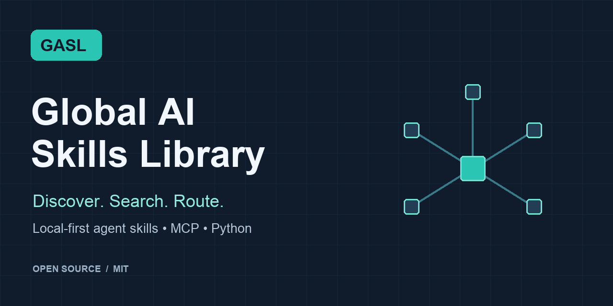
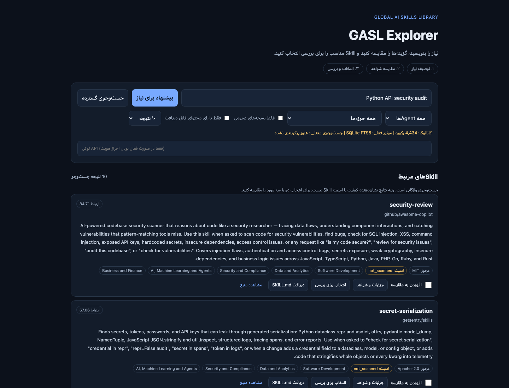
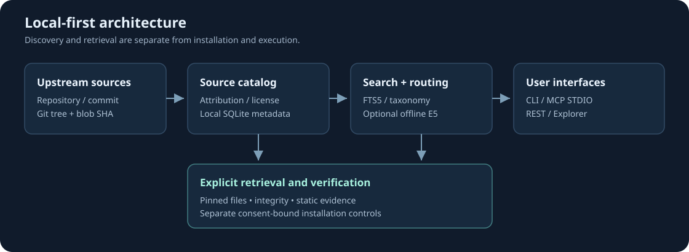

# کتابخانه جهانی Skillهای هوش مصنوعی (GASL)



**[English](README.md) · [فارسی](README.fa.md) · [简体中文](README.zh-CN.md)**

[](https://github.com/Mahdi-Soleimani/global-ai-skills-library/actions/workflows/gasl-cross-platform.yml) [](LICENSE) [](https://www.python.org/) [](MCP_CONFIG.example.json)

**کشف، جست‌وجو و پیشنهاد Skillهای Agent به‌صورت محلی.** GASL یک موتور متن‌باز Python و سرور MCP است که به توسعه‌دهندگان کمک می‌کند Skill مرتبط با نیاز خود را پیدا کنند، منشأ آن را بررسی کنند و فایل‌های انتخاب‌شده را از منبع اصلی دریافت کنند. برای استفاده معمولی به سرور اختصاصی، API پولی مدل زبانی یا Docker نیاز نیست.

کاتالوگ در snapshot مورخ ۲۴ نوامبر ۲۰۲۶ شامل **۴٬۴۳۴ رکورد پین‌شده به Commit از ۵۷ مخزن** است. این تعداد رکورد است، نه ادعای تعداد Skillهای یکتا، کیفیت یا مجوز نصب.

## قابلیت‌ها

| قابلیت | کاربرد |
| --- | --- |
| کاتالوگ Skill | اطلاعات منشأ و نسخه ثابت Git |
| جست‌وجوی محلی | SQLite FTS5 و دسته‌بندی، جست‌وجوی فارسی و انگلیسی |
| پیشنهاد بر اساس وظیفه | رتبه‌بندی واژگانی آزمایشی و قابل توضیح |
| اتصال MCP | شش ابزار فقط‌خواندنی از طریق STDIO محلی |
| Explorer | جست‌وجو، فیلتر، مقایسه و بررسی در مرورگر |
| دریافت تأییدپذیر | انتخاب صریح، Git Blob، SHA-256 و شواهد استاتیک |
| چندسکویی | Python 3.10+ روی macOS، Linux و Windows |
| جست‌وجوی معنایی اختیاری | شاخص آفلاین E5 با مدل جداگانه، آزمایشی |

## شروع سریع

Git و [Python 3.10 یا جدیدتر](https://www.python.org/downloads/) را نصب کنید. جست‌وجو و Explorer از کتابخانه استاندارد و SQLite FTS5 استفاده می‌کنند؛ وابستگی MCP اختیاری است.

**macOS و Linux**

```bash
git clone https://github.com/Mahdi-Soleimani/global-ai-skills-library.git
cd global-ai-skills-library
./gasl search --query "Python API security audit" --limit 5
./gasl serve
```

**Windows (PowerShell)**

```powershell
git clone https://github.com/Mahdi-Soleimani/global-ai-skills-library.git
cd global-ai-skills-library
python -I -B -X utf8 tools/runtime_launch.py search --query "Python API security audit" --limit 5
python -I -B -X utf8 tools/runtime_launch.py serve
```

در زمان اجرای سرور [http://127.0.0.1:8787](http://127.0.0.1:8787) را باز کنید. برای توقف Ctrl+C بزنید. سرور به‌صورت پیش‌فرض فقط روی loopback گوش می‌دهد. تصویر زیر نتیجه واقعی جست‌وجو در رابط فارسی Explorer است.



## اتصال به MCP

ابتدا SDK اختیاری MCP را محلی نصب کنید و سپس سرور را اجرا کنید.

```bash
./install.sh
./gasl mcp
```

```powershell
python -I -B -X utf8 tools/runtime_setup.py
python -I -B -X utf8 tools/runtime_launch.py mcp
```

از [نمونه تنظیمات JSON](MCP_CONFIG.example.json) یا [نمونه TOML برای Codex](MCP_CONFIG.codex.example.toml) استفاده کنید و مسیر نمونه را با مسیر مطلق پروژه جایگزین کنید. در ویندوز، مسیر مطلق `.venv/Scripts/python.exe` را به‌عنوان command و آرگومان‌های جداگانه `-I -B -X utf8 C:/ABSOLUTE/PATH/tools/gasl.py mcp` را در آرایه JSON قرار دهید. تنظیمات Agent به‌صورت خودکار تغییر نمی‌کند. برای Codex، Cursor و Claude Code مسیرهای اتصال یا نصب مستند شده‌اند؛ سازگاری عملی همه محدوده‌ها تأیید نشده است. [مرجع پیشرفته](https://github.com/Mahdi-Soleimani/global-ai-skills-library/blob/9e49dd49afe18e6299f858fe9103419d294564ab/README.md) حدود این قابلیت‌ها را توضیح می‌دهد.

## جست‌وجو و دریافت Skill

به‌جای `YOUR_SOURCE_RECORD_ID` شناسه حاصل از جست‌وجو را بگذارید. دستور اول download فقط برنامه دریافت را نمایش می‌دهد؛ دستور دوم با درخواست صریح فایل‌ها را در کاتالوگ محلی دریافت می‌کند و آن‌ها را نصب یا اجرا نمی‌کند. دریافت محتوای ذخیره‌نشده نیازمند شبکه است. Skillهای واقع در ریشه مخزن نیازمند مسیر جداگانه `root-skill-review` هستند.

```bash
./gasl route --task "Review a Python API for security issues" --top-k 5
./gasl search --query "security audit" --json
./gasl get --id YOUR_SOURCE_RECORD_ID
./gasl download --id YOUR_SOURCE_RECORD_ID
./gasl download --id YOUR_SOURCE_RECORD_ID --execute
./gasl audit --id YOUR_SOURCE_RECORD_ID
```

در ویندوز به جای `./gasl` از `python -I -B -X utf8 tools/runtime_launch.py` استفاده کنید. برای فهرست دستورها، راهنمای `--help` را اجرا کنید.

## معماری



جست‌وجو و پیشنهاد محلی هستند. دریافت صریح ممکن است به مخزن اصلی متصل شود. جست‌وجوی مدل‌محور از موتور پیش‌فرض FTS5 جداست. اجرای خودکار کد ثالث یا نصب بدون رضایت مجاز نیست.

## سازگاری و امنیت

- آزمون‌های خودکار و اجرای مستقل روی سه سیستم‌عامل انجام می‌شوند؛ آزمون واقعی Hostها محدود است و نصب Windows User Profile همچنان گیت دارد. اجرای بومی E5 روی همه سیستم‌عامل‌ها تأیید نشده است.
- پیشنهاد Skill یا نتیجه اسکن استاتیک به معنای تضمین کیفیت، امنیت یا مجوز نصب نیست. ارزیابی رفتاری اختیاری است و شرط ورود به کاتالوگ یا پذیرش MVP نیست.
- مخزن کد عمومی است، اما ZIP مستقل هنوز انتشار رسمی عمومی ندارد.
- مجوز MIT فقط برای نرم‌افزار اختصاصی GASL و مستندات اصیل آن است؛ حقوق Skillها، محتوای ثالث، داده‌ها و وابستگی‌ها مستقل می‌مانند.

## مستندات و مشارکت

[نقشه راه](docs/ROADMAP.md) · [گزارش‌های فنی](https://github.com/Mahdi-Soleimani/global-ai-skills-library/tree/main/docs/reports) · [مرجع پیشرفته تاریخی](https://github.com/Mahdi-Soleimani/global-ai-skills-library/blob/9e49dd49afe18e6299f858fe9103419d294564ab/README.md) · [راهنمای مشارکت](CONTRIBUTING.md) · [سیاست امنیتی](SECURITY.md) · [انتساب منابع](ATTRIBUTION.md) · [اعلان‌های ثالث](THIRD_PARTY_NOTICES.md) · [آیین رفتار](CODE_OF_CONDUCT.md) · [استناد](CITATION.cff)

برای گزارش مشکل یا پیشنهاد قابلیت، [Issue ثبت کنید](https://github.com/Mahdi-Soleimani/global-ai-skills-library/issues). مشارکت از طریق Pull Request پذیرفته می‌شود. [مجوز MIT](LICENSE).
