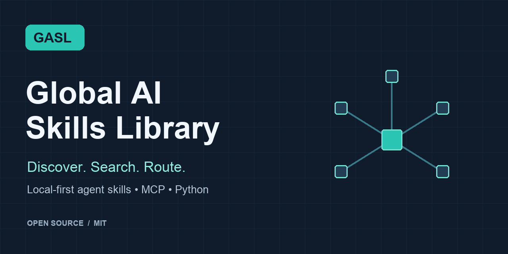
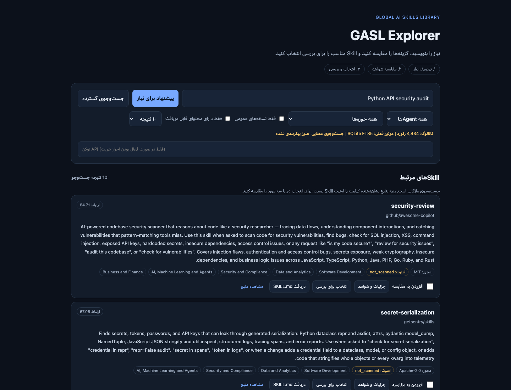
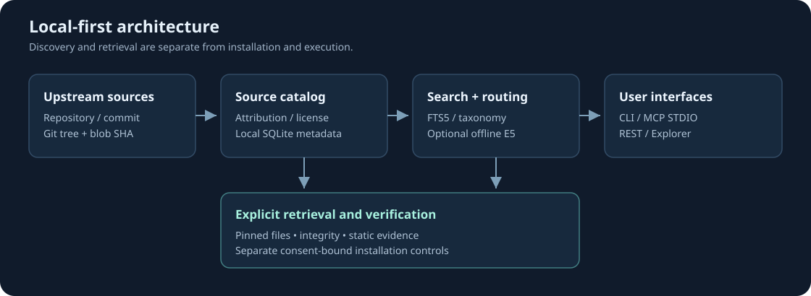

# Global AI Skills Library (GASL)



**[English](README.md) · [فارسی](README.fa.md) · [简体中文](README.zh-CN.md)**

[](https://github.com/Mahdi-Soleimani/global-ai-skills-library/actions/workflows/gasl-cross-platform.yml) [](LICENSE) [](https://www.python.org/) [](MCP_CONFIG.example.json)
[](https://m8ven.ai/mcp/mahdi-soleimani-global-ai-skills-library-9kfctw?s=readme)

**Discover, search and route AI agent skills locally.** GASL is an open-source Python skill discovery engine and Model Context Protocol (MCP) server that helps developers find relevant agent skills, inspect their upstream provenance and retrieve selected files. No hosted GASL service, paid LLM API or Docker is required for ordinary use.

The November 24, 2026 catalog snapshot contains **4,434 commit-pinned source records from 57 repositories**. These are catalog records, not an assertion of unique skills, quality ratings or installation approval.

## Why GASL?

| Capability | What you get |
| --- | --- |
| Skill discovery | Attributed source catalog with immutable Git references |
| Local search | SQLite FTS5, taxonomy-aware English and Persian queries |
| Task routing | Relevant candidates with explainable, experimental lexical scores |
| MCP integration | Six read-only tools over local STDIO |
| Web Explorer | Search, filter, compare and review skills in your browser |
| Verified retrieval | Explicit selection, pinned Git blobs, SHA-256 and static evidence |
| Portability | Python 3.10+ on macOS, Linux and Windows |
| Optional semantic search | Offline E5 index with separately supplied model; experimental |

## Quick start

Install Git and [Python 3.10 or later](https://www.python.org/downloads/). Search and Explorer use the standard library and SQLite FTS5; MCP dependencies are optional.

**macOS / Linux**

```bash
git clone https://github.com/Mahdi-Soleimani/global-ai-skills-library.git
cd global-ai-skills-library
./gasl search --query "Python API security audit" --limit 5
./gasl serve
```

**Windows (PowerShell)**

```powershell
git clone https://github.com/Mahdi-Soleimani/global-ai-skills-library.git
cd global-ai-skills-library
python -I -B -X utf8 tools/runtime_launch.py search --query "Python API security audit" --limit 5
python -I -B -X utf8 tools/runtime_launch.py serve
```

Open [http://127.0.0.1:8787](http://127.0.0.1:8787) while the server is running. Stop it with Ctrl+C. The default server binds only to loopback. The example below shows actual search results in the current Persian-language Explorer.



## Connect an MCP client

Install the local optional MCP SDK, then launch GASL using one of these platform-specific command pairs.

```bash
./install.sh
./gasl mcp
```

```powershell
python -I -B -X utf8 tools/runtime_setup.py
python -I -B -X utf8 tools/runtime_launch.py mcp
```

Use [MCP JSON configuration](MCP_CONFIG.example.json) or the [Codex TOML example](MCP_CONFIG.codex.example.toml) and replace the example path with your absolute checkout path. On Windows, set the command to the absolute `.venv/Scripts/python.exe` and arguments to `-I -B -X utf8 C:/ABSOLUTE/PATH/tools/gasl.py mcp` as separate JSON array elements. Set up your client manually; GASL does not edit agent configuration. Codex, Cursor and Claude Code have documented integration or installation workflows; real Host compatibility is not certified for every scope. See [advanced reference](https://github.com/Mahdi-Soleimani/global-ai-skills-library/blob/9e49dd49afe18e6299f858fe9103419d294564ab/README.md) for the detailed boundaries.

## Find and retrieve a skill

Replace `YOUR_SOURCE_RECORD_ID` with an ID from search. The first download call previews the plan. The second explicitly retrieves files into a local ignored catalog; it does not install or run them. Network access is needed for uncached upstream retrieval. Root-level skills require the separate `root-skill-review` workflow.

```bash
./gasl route --task "Review a Python API for security issues" --top-k 5
./gasl search --query "security audit" --json
./gasl get --id YOUR_SOURCE_RECORD_ID
./gasl download --id YOUR_SOURCE_RECORD_ID
./gasl download --id YOUR_SOURCE_RECORD_ID --execute
./gasl audit --id YOUR_SOURCE_RECORD_ID
```

On Windows, replace `./gasl` in these examples with `python -I -B -X utf8 tools/runtime_launch.py`. Run `./gasl --help` (or the Windows equivalent) for all commands.

## Architecture



Search and routing work locally; explicit retrieval can contact pinned upstream sources. Optional model-based search is separate from the default FTS5 engine. No automatic third-party execution or unconsented installation.

## Compatibility and safety

- Automated regression and standalone runtime tests cover macOS, Linux and Windows. Real Host checks and native Windows user-profile installation remain limited or gated; optional E5 inference is not verified on every OS.
- A recommendation or clean static scan is not a quality rating, security certification or installation approval. Behavioral quality evaluation is optional, not a catalog-entry or MVP acceptance requirement.
- The source repository is public. The independently gated standalone ZIP is not an official public release.
- GASL code is MIT licensed. Third-party skills, mirrored files, upstream descriptions, datasets and dependencies retain their own terms.

## Documentation and community

[Roadmap](docs/ROADMAP.md) · [Technical reports](https://github.com/Mahdi-Soleimani/global-ai-skills-library/tree/main/docs/reports) · [Advanced reference (historical)](https://github.com/Mahdi-Soleimani/global-ai-skills-library/blob/9e49dd49afe18e6299f858fe9103419d294564ab/README.md) · [Contributing](CONTRIBUTING.md) · [Security policy](SECURITY.md) · [Attribution](ATTRIBUTION.md) · [Third-party notices](THIRD_PARTY_NOTICES.md) · [Code of conduct](CODE_OF_CONDUCT.md) · [Citation](CITATION.cff)

Found a bug or want to propose an improvement? [Open an issue](https://github.com/Mahdi-Soleimani/global-ai-skills-library/issues). Contributions are welcome through pull requests. See the [MIT License](LICENSE) for GASL-owned software and original associated documentation.
