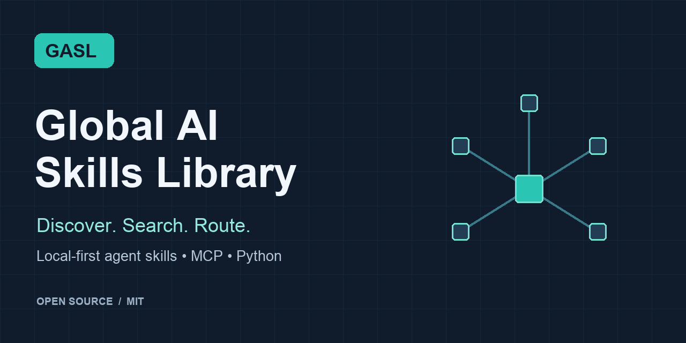
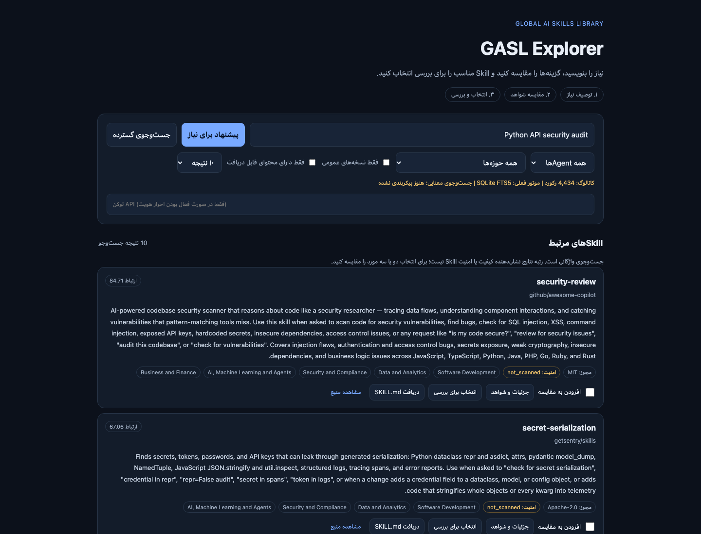
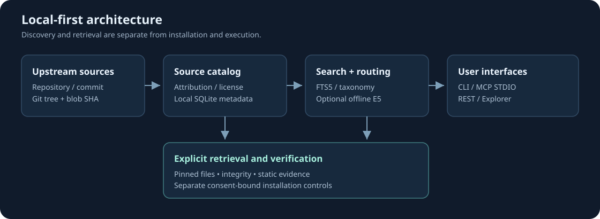

# Global AI Skills Library（GASL）— 全球 AI 智能体技能库



**[English](README.md) · [فارسی](README.fa.md) · [简体中文](README.zh-CN.md)**

[](https://github.com/Mahdi-Soleimani/global-ai-skills-library/actions/workflows/gasl-cross-platform.yml) [](LICENSE) [](https://www.python.org/) [](MCP_CONFIG.example.json)

**在本地发现、搜索和推荐 AI 智能体技能。** GASL 是一个开源 Python 技能发现引擎和模型上下文协议（MCP）服务器，帮助开发者找到与任务相关的技能，核验上游来源，并按需获取选定文件。日常使用无需托管 GASL 服务、付费大模型 API 或 Docker。

2026 年 11 月 24 日的目录快照包含 **来自 57 个仓库的 4,434 条固定到 Git 提交的来源记录**。记录数量不等于独立技能数量，也不代表质量评级或安装批准。

## 核心功能

| 功能 | 说明 |
| --- | --- |
| 技能发现 | 保留来源归属和不可变 Git 引用 |
| 本地搜索 | SQLite FTS5、分类体系及英语和波斯语查询 |
| 任务推荐 | 可解释的实验性词汇相关性排序 |
| MCP 集成 | 通过本地 STDIO 提供六个只读工具 |
| Web Explorer | 在浏览器中搜索、筛选、比较和查看技能 |
| 可验证获取 | 显式选择、固定 Git Blob、SHA-256 和静态检查证据 |
| 跨平台 | macOS、Linux 和 Windows 上的 Python 3.10+ |
| 可选语义搜索 | 使用单独提供模型的离线 E5 索引，实验功能 |

## 快速开始

安装 Git 和 [Python 3.10 或更高版本](https://www.python.org/downloads/)。搜索和 Explorer 使用 Python 标准库及 SQLite FTS5；MCP 依赖为可选项。

**macOS / Linux**

```bash
git clone https://github.com/Mahdi-Soleimani/global-ai-skills-library.git
cd global-ai-skills-library
./gasl search --query "Python API security audit" --limit 5
./gasl serve
```

**Windows（PowerShell）**

```powershell
git clone https://github.com/Mahdi-Soleimani/global-ai-skills-library.git
cd global-ai-skills-library
python -I -B -X utf8 tools/runtime_launch.py search --query "Python API security audit" --limit 5
python -I -B -X utf8 tools/runtime_launch.py serve
```

服务器运行时打开 [http://127.0.0.1:8787](http://127.0.0.1:8787)，按 Ctrl+C 停止。默认仅绑定本地回环地址。下图为当前波斯语 Explorer 界面的真实搜索结果。



## 连接 MCP 客户端

先安装可选的本地 MCP SDK，再按平台启动 GASL。

```bash
./install.sh
./gasl mcp
```

```powershell
python -I -B -X utf8 tools/runtime_setup.py
python -I -B -X utf8 tools/runtime_launch.py mcp
```

参考 [MCP JSON 配置](MCP_CONFIG.example.json) 或 [Codex TOML 示例](MCP_CONFIG.codex.example.toml)，将示例路径替换为项目的绝对路径。Windows 下将 command 设为 `.venv/Scripts/python.exe` 的绝对路径，并将 `-I -B -X utf8 C:/ABSOLUTE/PATH/tools/gasl.py mcp` 作为独立的 JSON 数组参数。请手动配置客户端；GASL 不会自动修改智能体配置。Codex、Cursor 和 Claude Code 有相应的集成或安装流程文档，但并非所有实际 Host 范围均已验证。详情见[高级参考](https://github.com/Mahdi-Soleimani/global-ai-skills-library/blob/9e49dd49afe18e6299f858fe9103419d294564ab/README.md)。

## 查找并获取技能

将 `YOUR_SOURCE_RECORD_ID` 替换为搜索结果中的来源 ID。首次 download 调用只预览计划，第二次显式获取文件到本地目录，不会安装或执行。未缓存的上游内容需要网络访问。仓库根目录的技能需使用单独的 `root-skill-review` 流程。

```bash
./gasl route --task "Review a Python API for security issues" --top-k 5
./gasl search --query "security audit" --json
./gasl get --id YOUR_SOURCE_RECORD_ID
./gasl download --id YOUR_SOURCE_RECORD_ID
./gasl download --id YOUR_SOURCE_RECORD_ID --execute
./gasl audit --id YOUR_SOURCE_RECORD_ID
```

Windows 下请将示例中的 `./gasl` 替换为 `python -I -B -X utf8 tools/runtime_launch.py`。运行 `--help` 查看完整命令。

## 架构



默认搜索和推荐在本地完成；显式获取可能访问固定版本的上游仓库。可选语义搜索独立于默认 FTS5 引擎。不会自动执行第三方技能或未经同意安装。

## 兼容性与安全

- 自动化回归和独立运行测试覆盖三个操作系统；实际 Host 测试仍有限，Windows 用户配置范围的安装受安全门控。E5 本地推理尚未在所有系统验证。
- 推荐结果或静态扫描通过不等于质量评级、安全认证或安装许可。行为质量评价是可选项，不是目录收录或 MVP 验收条件。
- 源代码仓库公开，但独立 ZIP 尚未正式公开发布。
- MIT 仅适用于 GASL 自有软件和原创配套文档；第三方技能、镜像文件、上游描述、数据集与依赖保持各自条款。

## 文档与社区

[路线图](docs/ROADMAP.md) · [技术报告](https://github.com/Mahdi-Soleimani/global-ai-skills-library/tree/main/docs/reports) · [历史高级参考](https://github.com/Mahdi-Soleimani/global-ai-skills-library/blob/9e49dd49afe18e6299f858fe9103419d294564ab/README.md) · [贡献指南](CONTRIBUTING.md) · [安全政策](SECURITY.md) · [来源归属](ATTRIBUTION.md) · [第三方声明](THIRD_PARTY_NOTICES.md) · [行为准则](CODE_OF_CONDUCT.md) · [引用](CITATION.cff)

发现问题或有改进建议？请[提交 Issue](https://github.com/Mahdi-Soleimani/global-ai-skills-library/issues)。欢迎通过 Pull Request 贡献代码。[MIT 许可证](LICENSE)。
